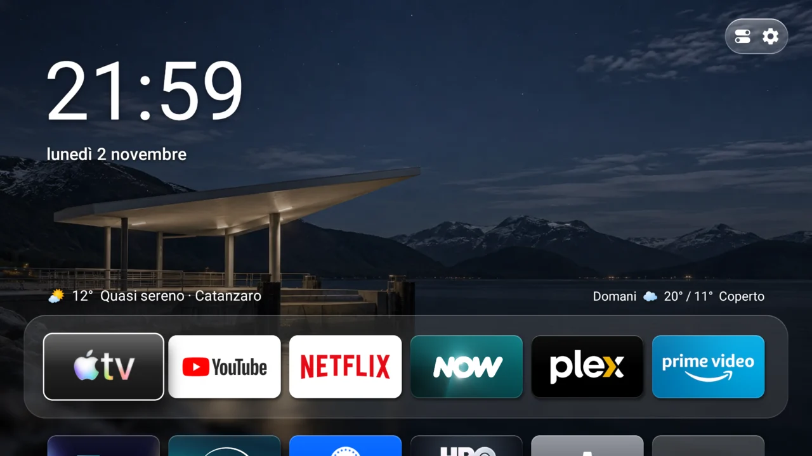
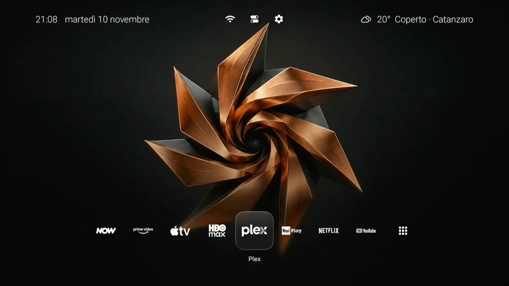
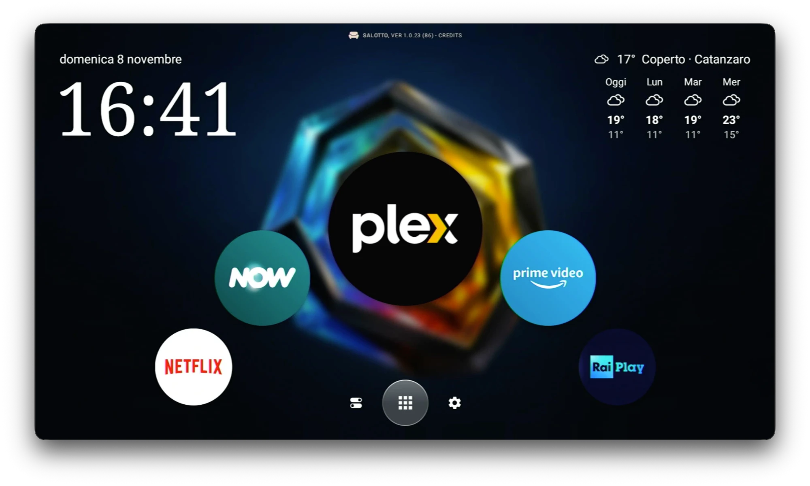
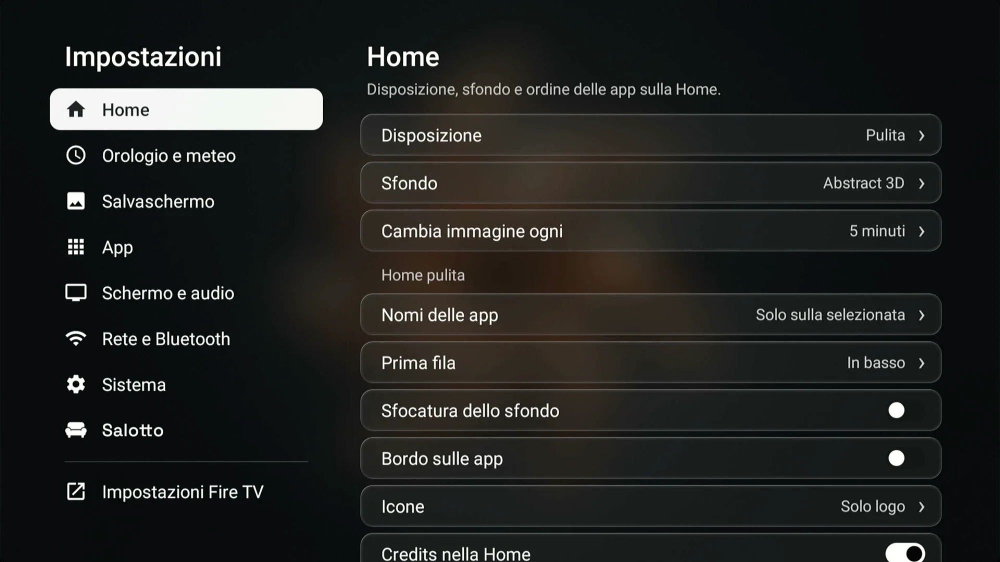

<a href="README.md">English</a> · <b>Italiano</b>

 

Una Home pulita per Fire TV Stick: le tue app, lo sfondo, l'orario e il meteo. Niente pubblicità, niente contenuti consigliati e niente video automatici.

## Fire TV supportate

| Codice | Modello | Generazione | Anno | Funzioni |
|---|---|---|---|---|
| `AFTKM` | Fire TV Stick 4K | 2ª | 2023 | Tutte |
| `AFTKRT` | Fire TV Stick 4K Max | 2ª | 2023 | Tutte |
| `AFTKA` | Fire TV Stick 4K Max | 1ª | 2021 | Alcune limitate |
| `AFTSSS` | Fire TV Stick | 3ª | 2020 | Alcune limitate |
| `AFTSS` | Fire TV Stick Lite | 1ª | 2020 | Alcune limitate |

## Installazione

Installa Salotto guida ogni passo dal computer, e con Togli Salotto rimette tutto com'era.

| Computer | Installer |
|---|---|
| Mac Apple Silicon | **[Scarica Installa Salotto per Mac](https://github.com/simplemal/salotto-tv/releases/latest/download/Installa-Salotto-Mac.dmg)** |
| Windows | **[Scarica Installa Salotto per Windows](https://github.com/simplemal/salotto-tv/releases/latest/download/Installa-Salotto-Windows.exe)** |
| Linux | **[Scarica Installa Salotto per Linux](https://github.com/simplemal/salotto-tv/releases/latest/download/Installa-Salotto-Linux.AppImage)** (AppImage: rendilo eseguibile, poi aprilo) |

## Cosa fa

- **Home:** griglia delle tue app, sfondi che seguono il meteo e l'ora della tua città, oppure illustrazioni, sculture 3D e città notturne che cambiano da sole.
- **Dieci lingue:** italiano, inglese, spagnolo, francese, tedesco, portoghese, russo, arabo, hindi e cinese.
- **Primo avvio:** una presentazione guidata prima della Home.
- **Salvaschermi:** le stesse immagini, con solo ora e data.
- **Centro di controllo:** tieni premuto Menu per Wi-Fi, Bluetooth, timer, luminosità e, dove possibile, filtro luce blu.
- **Task manager:** tieni premuto Indietro.
- **Meno tracciamento:** l'installazione spegne i pacchetti di pubblicità, telemetria e Alexa, limita l'identificativo pubblicitario e ferma l'invio dei dati d'uso. Se Fire OS li riattiva, Salotto te lo dice.
- **Aggiornamenti:** firmati e controllati prima di installarli, con un passo per volta a schermo.

Salotto si collega solo a Open-Meteo per il meteo e a GitHub per gli aggiornamenti. Niente root e niente modifiche al sistema: resta una normale app, e si può disinstallare.

## Com'è

Home Pulita

Home circolare. Pulita, Circolare e Vetro si scelgono in Aspetto › Disposizione

Impostazioni

## Come è fatto il repository

- `home/app`: l'app Salotto, in Java, senza librerie esterne a parte un piccolo generatore di codici QR.
- `home/cover`: una piccola app che tiene a schermo la pagina di aggiornamento mentre Android sostituisce Salotto.
- `distro`: script di installazione e disinstallazione, elenchi dei pacchetti, guide e strumenti di pubblicazione.

Per compilare servono JDK 17, Android SDK e Gradle 8.9: `gradle :app:assembleDebug` dalla cartella `home`.

## Aggiornamenti ed errori

Ogni versione è una [release](https://github.com/simplemal/salotto-tv/releases) con l'APK, `update.json` e la sua firma. Salotto installa solo ciò che è firmato con la chiave giusta.

Se sulla TV compare un codice, cercalo in [ERRORI.md](ERRORI.md). Per tutto il resto [apri una segnalazione](https://github.com/simplemal/salotto-tv/issues/new).

## Problemi e nuove idee

Per segnalare un problema o proporre una funzione nuova, apri una [segnalazione su GitHub](https://github.com/simplemal/salotto-tv/issues/new): serve solo un account GitHub gratuito. Prima guarda tra le [segnalazioni già aperte](https://github.com/simplemal/salotto-tv/issues): se c'è già, aggiungi un commento o un 👍.

- **Problema:** indica il modello della Fire TV e la versione di Salotto (in Impostazioni → Informazioni su Salotto), cosa hai fatto e cosa è successo. Se c'è un codice di errore, scrivilo o allega una foto dello schermo. Per i problemi d'installazione, in Installa Salotto premi «Segnala un problema»: salva sulla Scrivania un file da allegare.
- **Nuova funzione:** descrivi cosa ti servirebbe e quando lo useresti.

## Sostieni Salotto

Salotto è gratuito e open-source. Se ti è stato utile e vuoi sostenerne lo sviluppo, anche per nuove piattaforme, puoi offrirmi un caffè ☕

## Licenza

[PolyForm Noncommercial 1.0.0](LICENSE): si può usare, studiare, modificare e derivare gratis per scopi non commerciali. Per venderlo serve il permesso dell'autore. Crediti e software di altri sono in [NOTICE.md](NOTICE.md).

Salotto è un progetto indipendente. Non è affiliato, sponsorizzato né approvato da Amazon, Apple o dagli altri marchi citati, che appartengono ai rispettivi proprietari.
