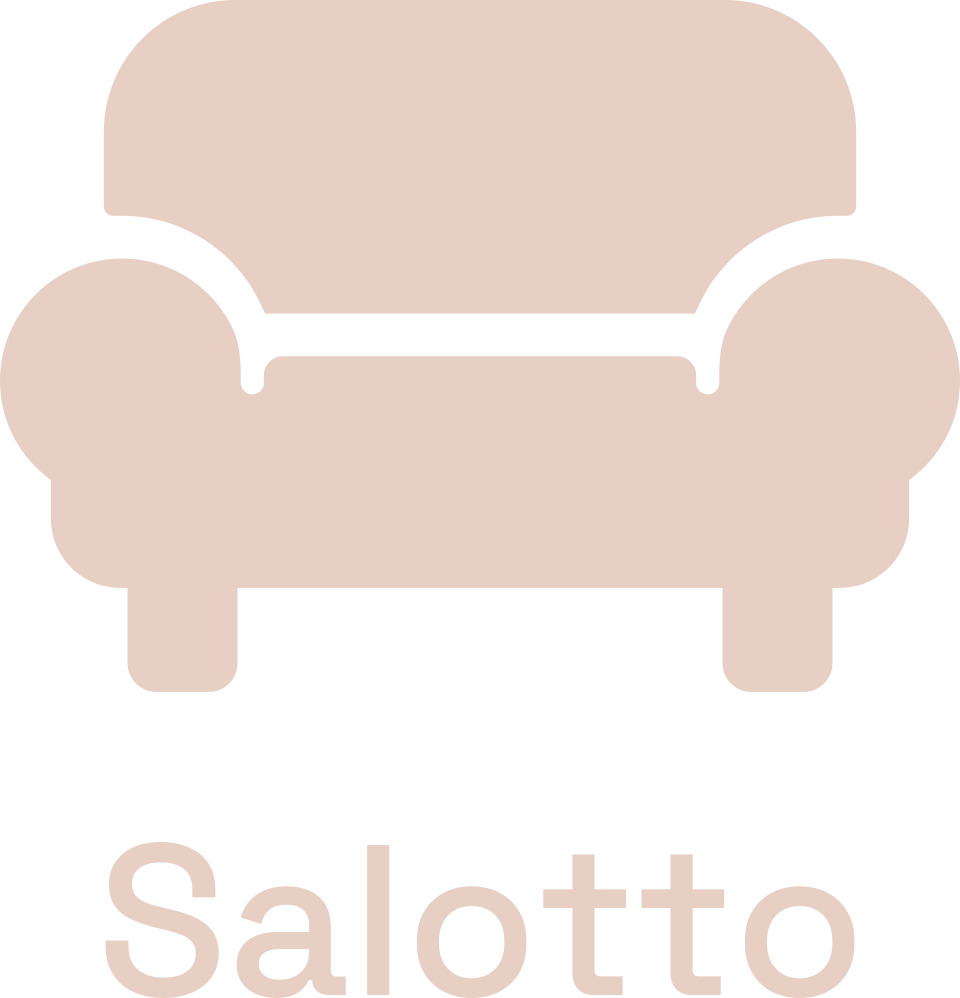
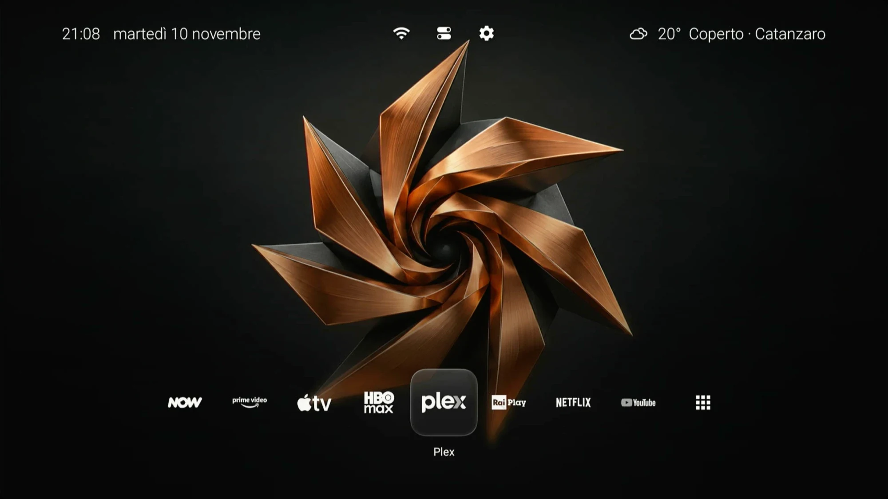
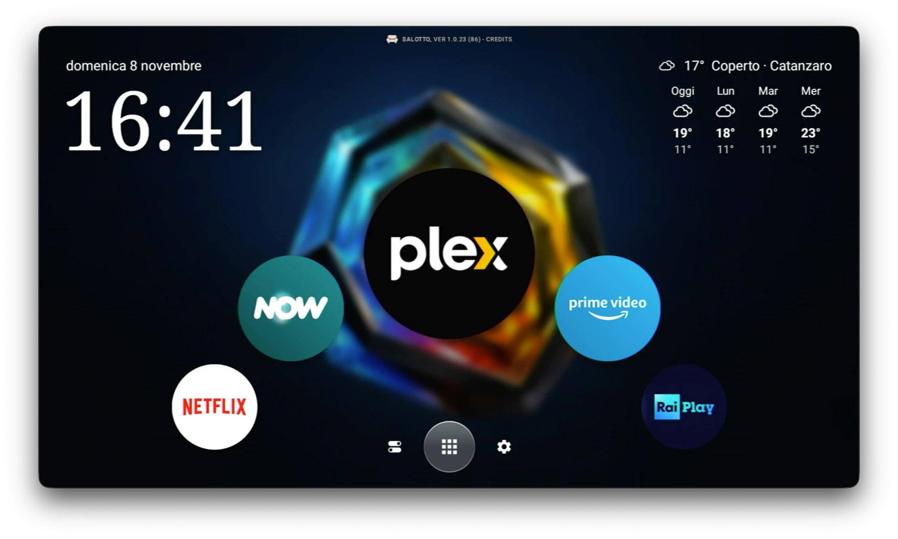
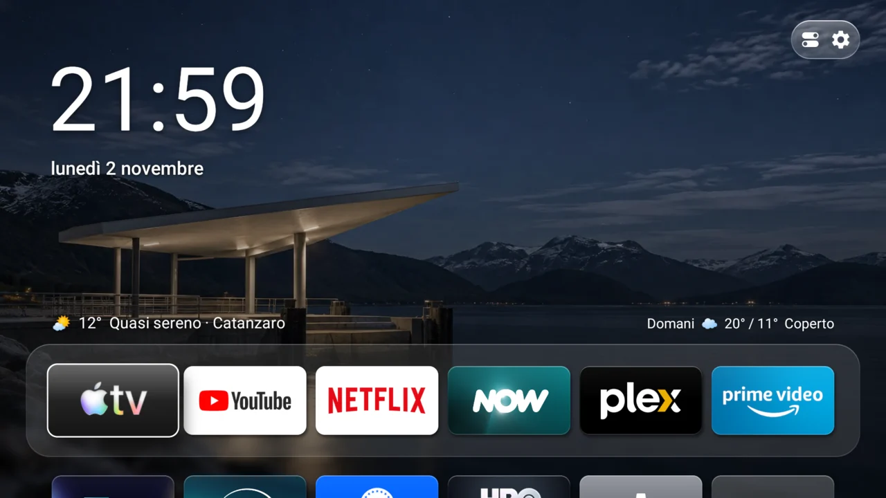
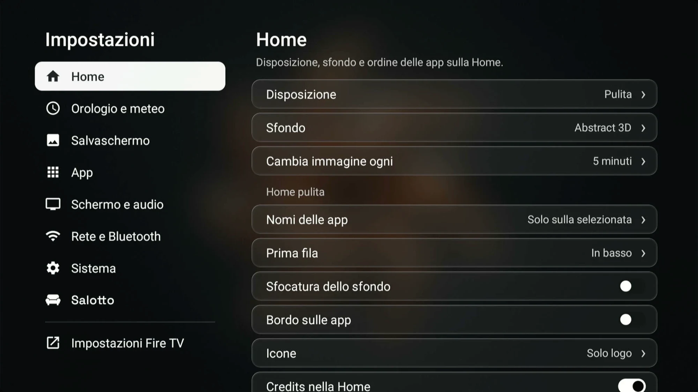

<a href="README.md">English</a> · <b>Italiano</b>

 

Home Pulita con Icone › Solo logo: le app sono loghi bianchi e quella selezionata ha la sua tile di vetro. Orario, data, Centro di controllo e meteo stanno in una riga in alto.

Una Home pulita per Fire TV Stick: le tue app, lo sfondo, l'orario e il meteo. Niente pubblicità, niente contenuti consigliati e niente video automatici.

## Fire TV supportate

| Codice | Modello | Anno | Funzioni |
|---|---|---|---|
| `AFTMA08C15` | Fire TV Stick 4K Plus | 2025 | Tutte |
| `AFTSS` | Fire TV Stick HD | 2024 | Alcune limitate [²](#nota-2) |
| `AFTKM` | Fire TV Stick 4K (2ª) | 2023 | Tutte |
| `AFTKRT` | Fire TV Stick 4K Max (2ª) | 2023 | Tutte |
| `AFTKA` | Fire TV Stick 4K Max (1ª) | 2021 | Poche limitazioni [¹](#nota-1) |
| `AFTSSS` | Fire TV Stick (3ª) | 2020 | Alcune limitate [²](#nota-2) |
| `AFTSS` | Fire TV Stick Lite (1ª) | 2020 | Alcune limitate [²](#nota-2) |
| `AFTMM` | Fire TV Stick 4K (1ª) | 2018 | Non compatibile [³](#nota-3) |
| `AFTN` | Fire TV (3ª) | 2017 | Non compatibile [³](#nota-3) |
| `AFTT` | Fire TV Stick Basic Edition | 2017 | Non compatibile [⁴](#nota-4) |
| `AFTT` | Fire TV Stick (2ª) | 2016 | Non compatibile [⁴](#nota-4) |
| `AFTS` | Fire TV (2ª) | 2015 | Non compatibile [⁴](#nota-4) |
| `AFTM` | Fire TV Stick (1ª) | 2014 | Non compatibile [⁴](#nota-4) |
| `AFTB` | Fire TV (1ª) | 2014 | Non compatibile [⁴](#nota-4) |

Salotto non può funzionare sulle Fire TV recenti con Vega OS, poiché non consente di installare app Android come Salotto.

Per quanto Salotto possa teoricamente funzionare sulla maggior parte dei televisori Fire TV e dei Fire TV Cube con Android, l'installazione non è stata abilitata perché non è possibile provarla direttamente.

## Installazione

Salotto TV Setup guida ogni passo dal computer, e con Togli Salotto rimette tutto com'era.

| Computer | Installer |
|---|---|
| Mac Apple Silicon | **[Scarica Salotto TV Setup per Mac](https://github.com/simplemal/salotto-tv/releases/latest/download/Salotto-TV-Setup.dmg)** |
| Windows | **[Scarica Salotto TV Setup per Windows](https://github.com/simplemal/salotto-tv/releases/latest/download/Salotto-TV-Setup.exe)** |
| Linux | **[Scarica Salotto TV Setup per Linux](https://github.com/simplemal/salotto-tv/releases/latest/download/Salotto-TV-Setup.AppImage)** (AppImage: rendilo eseguibile, poi aprilo) |

## Cosa fa

- **Home:** griglia delle tue app, sfondi che seguono il meteo e l'ora della tua città, oppure illustrazioni, sculture 3D e città notturne che cambiano da sole.
- **Dieci lingue:** italiano, inglese, spagnolo, francese, tedesco, portoghese, russo, arabo, hindi e cinese.
- **Primo avvio:** una presentazione guidata prima della Home.
- **Salvaschermi:** le stesse immagini, con solo ora e data.
- **Centro di controllo:** tieni premuto Menu per Wi-Fi, Bluetooth, timer, luminosità e, dove possibile, filtro luce blu.
- **Task manager:** tieni premuto Indietro.
- **Meno tracciamento:** l'installazione spegne i pacchetti di pubblicità, telemetria e Alexa, limita l'identificativo pubblicitario e ferma l'invio dei dati d'uso. Se Fire OS li riattiva, Salotto te lo dice.
- **Aggiornamenti:** firmati e controllati prima di installarli, con un passo per volta a schermo.

Salotto si collega solo a Open-Meteo per il meteo e a GitHub per gli aggiornamenti. Niente root e niente modifiche al sistema: resta una normale app, e si può disinstallare.

## Com'è

Home Circolare con Semicerchio › 5 app e Sfocatura dello sfondo: le app su una ruota che gira con le frecce, quella accesa più grande in alto, con l'orario grande e le previsioni dei prossimi giorni.

Home Vetro: le app in una griglia di vetro, la prima fila sotto l'orario grande e il meteo di oggi e di domani.

Impostazioni › Home: qui si sceglie la disposizione, Pulita, Circolare o Vetro, insieme a sfondo e icone.

## Come è fatto il repository

- `home/app`: l'app Salotto, in Java, senza librerie esterne a parte un piccolo generatore di codici QR.
- `home/cover`: una piccola app che tiene a schermo la pagina di aggiornamento mentre Android sostituisce Salotto.
- `distro`: script di installazione e disinstallazione, elenchi dei pacchetti, guide e strumenti di pubblicazione.

Per compilare servono JDK 17, Android SDK e Gradle 8.9: `gradle :app:assembleDebug` dalla cartella `home`.

## Aggiornamenti ed errori

Ogni versione è una [release](https://github.com/simplemal/salotto-tv/releases) con l'APK, `update.json` e la sua firma. Salotto installa solo ciò che è firmato con la chiave giusta.

Se sulla TV compare un codice, cercalo in [ERRORI.md](ERRORI.md). Per tutto il resto [apri una segnalazione](https://github.com/simplemal/salotto-tv/issues/new).

## Problemi e nuove idee

Per segnalare un problema o proporre una funzione nuova, apri una [segnalazione su GitHub](https://github.com/simplemal/salotto-tv/issues/new): serve solo un account GitHub gratuito. Prima guarda tra le [segnalazioni già aperte](https://github.com/simplemal/salotto-tv/issues): se c'è già, aggiungi un commento o un 👍.

- **Problema:** indica il modello della Fire TV e la versione di Salotto (in Impostazioni → Informazioni su Salotto), cosa hai fatto e cosa è successo. Se c'è un codice di errore, scrivilo o allega una foto dello schermo. Per i problemi d'installazione, in Salotto TV Setup premi «Segnala un problema»: salva sulla Scrivania un file da allegare.
- **Nuova funzione:** descrivi cosa ti servirebbe e quando lo useresti.

## Sostieni Salotto

Salotto è gratuito e open-source. Se ti è stato utile e vuoi sostenerne lo sviluppo, anche per nuove piattaforme, puoi offrirmi un caffè ☕

## Licenza

[PolyForm Noncommercial 1.0.0](LICENSE): si può usare, studiare, modificare e derivare gratis per scopi non commerciali. Per venderlo serve il permesso dell'autore. Crediti e software di altri sono in [NOTICE.md](NOTICE.md).

Salotto è un progetto indipendente. Non è affiliato, sponsorizzato né approvato da Amazon, Apple o dagli altri marchi citati, che appartengono ai rispettivi proprietari.

---

¹ Fire OS 7: niente numero delle notifiche sulla Home e niente pagina USB nelle Impostazioni; le reti Wi-Fi e la cancellazione dei dati di un'app si aprono nelle pagine di Fire OS; niente salvaschermo di Salotto, perché uscendo dal salvaschermo Fire OS 7 chiude Salotto: resta quello di Fire OS, che non si avvia dalle Impostazioni. 
² Come ¹, e inoltre: le app non si aprono con l'animazione dal cerchio; sotto le Impostazioni lo sfondo è nero invece della Home sfocata; lo sfondo cambia senza dissolvenza; risoluzione fino a 1080p. 
³ Fire OS 6 accetta solo servizi di accessibilità firmati da Amazon. Senza quello di Salotto il tasto Home riporta a Salotto dopo 5 secondi, all'accensione si vede prima la Home di Amazon, e mancano i tasti tenuti premuti, le immagini nel task manager e l'animazione delle app. Per questo ho scelto di non renderla disponibile. 
⁴ Fire OS 5 si basa su Android 5.1, mentre Salotto richiede almeno Android 7: non può funzionare.
