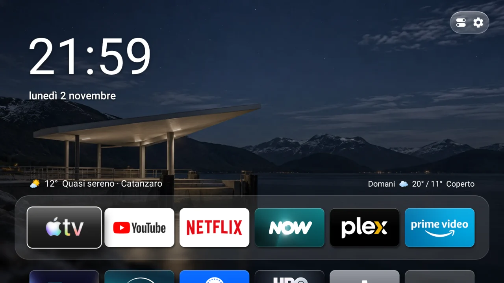
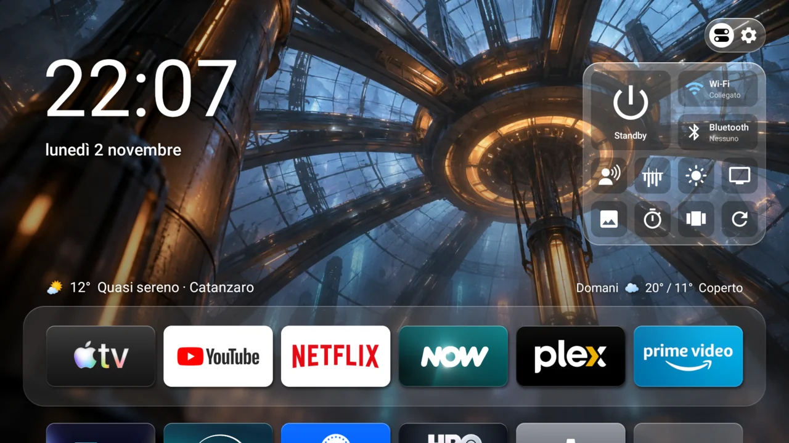
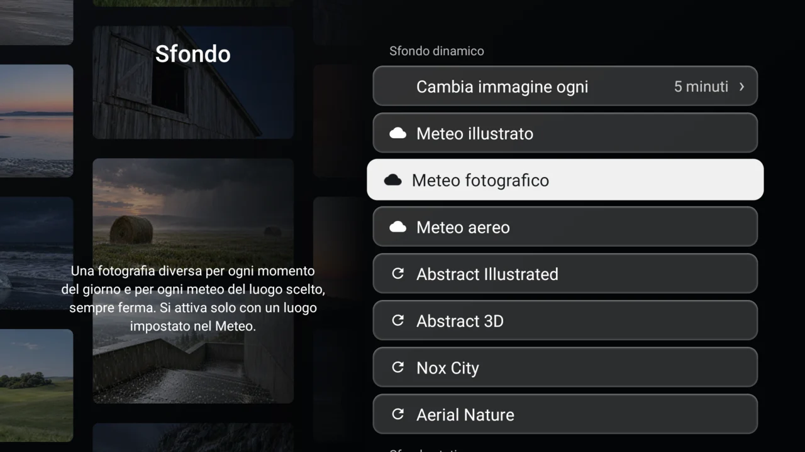

<h1 align="center"> Salotto</h1>

 

Una Home pulita per Fire TV Stick: le tue app, lo sfondo, l'orario e il meteo. Niente pubblicità, niente contenuti consigliati e niente video automatici.

## Fire TV supportate

- Fire TV Stick 4K 2ª generazione (2023)
- Fire TV Stick 4K Max 2ª generazione (2023)
- Fire TV Stick 4K Max 1ª generazione (2021), con alcune funzioni limitate

## Installazione

Installa Salotto guida ogni passo dal computer, e con Togli Salotto rimette tutto com'era.

| Computer | Installer |
|---|---|
| Mac Apple Silicon | **[Scarica Installa Salotto per Mac](https://github.com/simplemal/salotto-tv/releases/latest/download/Installa-Salotto-Mac.dmg)** |
| Windows | Con la prossima versione |

## Cosa fa

- **Home:** griglia delle tue app, sfondi che seguono il meteo e l'ora della tua città, oppure illustrazioni, sculture 3D e città notturne che cambiano da sole.
- **Dieci lingue:** italiano, inglese, spagnolo, francese, tedesco, portoghese, russo, arabo, hindi e cinese.
- **Primo avvio:** una presentazione guidata prima della Home.
- **Salvaschermi:** le stesse immagini, con solo ora e data.
- **Centro di controllo:** tieni premuto Menu per Wi-Fi, Bluetooth, timer, luminosità e, dove possibile, filtro luce blu.
- **Task manager:** tieni premuto Indietro.
- **Meno tracciamento:** l'installazione spegne i pacchetti di pubblicità, telemetria e Alexa, limita l'identificativo pubblicitario e ferma l'invio dei dati d'uso. Se Fire OS li riattiva, Salotto te lo dice.
- **Aggiornamenti:** firmati e controllati prima di installarli, con un passo per volta a schermo.

Salotto si collega solo a Open-Meteo per il meteo e a GitHub per gli aggiornamenti. Niente root e niente modifiche al sistema: resta una normale app, e si può disinstallare.

## Com'è

| Centro di controllo | Scelta dello sfondo | Task manager |
|---|---|---|
|  |  |  |

## Come è fatto il repository

- `home/app`: l'app Salotto, in Java, senza librerie esterne.
- `home/cover`: una piccola app che tiene a schermo la pagina di aggiornamento mentre Android sostituisce Salotto.
- `distro`: script di installazione e disinstallazione, elenchi dei pacchetti, guide e strumenti di pubblicazione.

Per compilare servono JDK 17, Android SDK e Gradle 8.9: `gradle :app:assembleDebug` dalla cartella `home`.

## Aggiornamenti ed errori

Ogni versione è una [release](https://github.com/simplemal/salotto-tv/releases) con l'APK, `update.json` e la sua firma. Salotto installa solo ciò che è firmato con la chiave giusta.

Se sulla TV compare un codice, cercalo in [ERRORI.md](ERRORI.md). Per tutto il resto [apri una segnalazione](https://github.com/simplemal/salotto-tv/issues/new).

## Licenza

[PolyForm Noncommercial 1.0.0](LICENSE): si può usare, studiare, modificare e derivare gratis per scopi non commerciali. Per venderlo serve il permesso dell'autore. Crediti e software di altri sono in [NOTICE.md](NOTICE.md).

Salotto è un progetto indipendente. Non è affiliato, sponsorizzato né approvato da Amazon, Apple o dagli altri marchi citati, che appartengono ai rispettivi proprietari.
