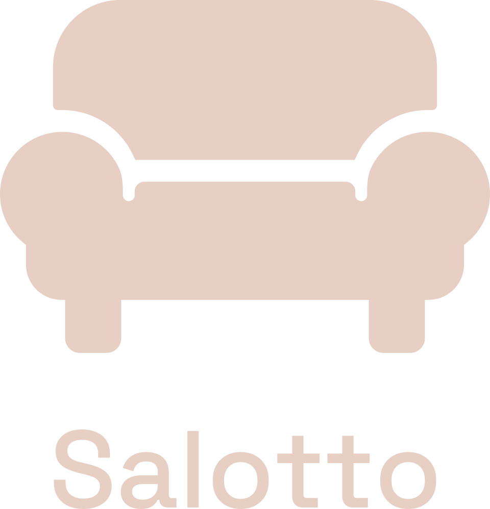
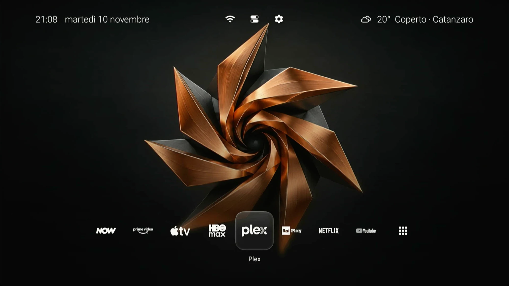
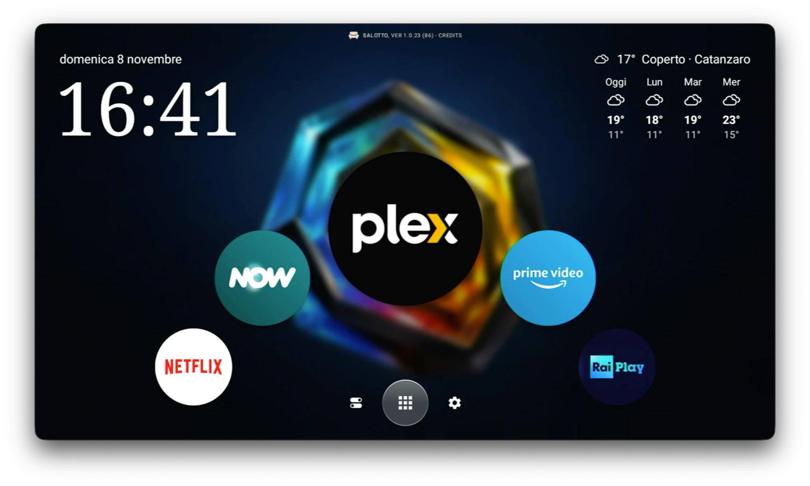
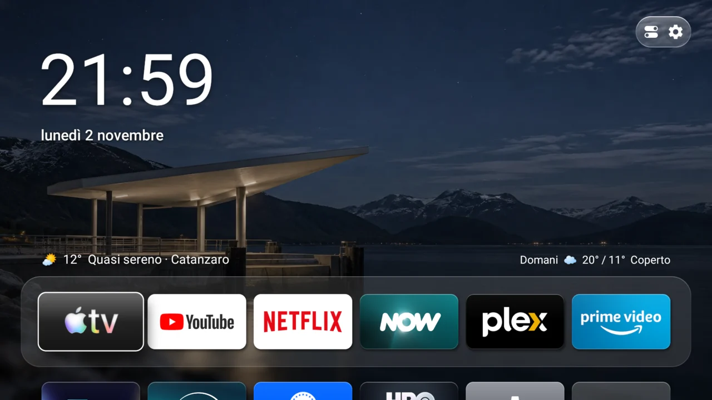
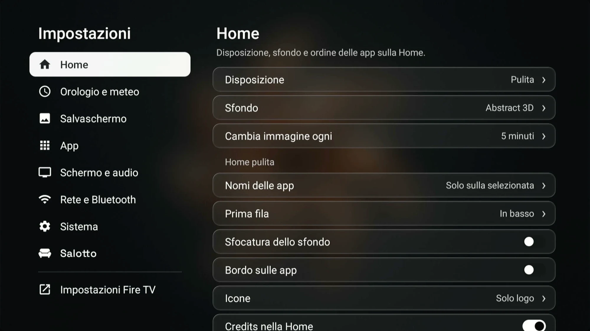

<b>English</b> · <a href="README.it.md">Italiano</a>

 

Clean Home with Icons › Logo only: the apps are white logos, and the selected one has its glass tile. Time, date, control center and weather sit in one line at the top.

A clean Home for Fire TV Stick: your apps, the backdrop, the time and the weather. No ads, no recommended content and no autoplaying videos.

## Supported Fire TVs

| Code | Model | Year | Features |
|---|---|---|---|
| `AFTMA08C15` | Fire TV Stick 4K Plus | 2025 | All |
| `AFTSS` | Fire TV Stick HD | 2024 | Some limited ² |
| `AFTKM` | Fire TV Stick 4K (2nd) | 2023 | All |
| `AFTKRT` | Fire TV Stick 4K Max (2nd) | 2023 | All |
| `AFTKA` | Fire TV Stick 4K Max (1st) | 2021 | Some limited ¹ |
| `AFTSSS` | Fire TV Stick (3rd) | 2020 | Some limited ² |
| `AFTSS` | Fire TV Stick Lite (1st) | 2020 | Some limited ² |
| `AFTMM` | Fire TV Stick 4K (1st) | 2018 | Not compatible ³ |
| `AFTN` | Fire TV (3rd) | 2017 | Not compatible ³ |
| `AFTT` | Fire TV Stick Basic Edition | 2017 | Not compatible ⁴ |
| `AFTT` | Fire TV Stick (2nd) | 2016 | Not compatible ⁴ |
| `AFTS` | Fire TV (2nd) | 2015 | Not compatible ⁴ |
| `AFTM` | Fire TV Stick (1st) | 2014 | Not compatible ⁴ |
| `AFTB` | Fire TV (1st) | 2014 | Not compatible ⁴ |

¹ Fire OS 7: no notification count on the Home and no USB page in the Settings; Wi-Fi networks and clearing an app's data open Fire OS's pages; no Salotto screensaver, because leaving a screensaver Fire OS 7 closes Salotto: Fire OS's stays, and it cannot be started from the Settings. 
² As ¹, and also: apps do not open with the animation from the circle; under the Settings the backdrop is black instead of the blurred Home; the backdrop changes without a fade; resolution up to 1080p. 
³ Fire OS 6 accepts only accessibility services signed by Amazon. Without Salotto's, the Home key brings Salotto back after 5 seconds, at power-on Amazon's Home shows first, and held-down keys, the pictures in the task manager and the apps' animation are missing. So I chose not to make it available. 
⁴ Fire OS 5 is based on Android 5.1, while Salotto needs at least Android 7: it cannot work.

Salotto cannot work on the recent Fire TVs with Vega OS, as it does not allow installing Android apps such as Salotto.

Although Salotto could in theory work on most Fire TV televisions and Fire TV Cubes with Android, installing on them has not been enabled because it cannot be tried directly.

## Installation

Salotto TV Setup guides every step from the computer, and with Remove Salotto it puts everything back as it was.

| Computer | Installer |
|---|---|
| Mac Apple Silicon | **[Download Salotto TV Setup for Mac](https://github.com/simplemal/salotto-tv/releases/latest/download/Salotto-TV-Setup.dmg)** |
| Windows | **[Download Salotto TV Setup for Windows](https://github.com/simplemal/salotto-tv/releases/latest/download/Salotto-TV-Setup.exe)** |
| Linux | **[Download Salotto TV Setup for Linux](https://github.com/simplemal/salotto-tv/releases/latest/download/Salotto-TV-Setup.AppImage)** (AppImage: make it executable, then open it) |

## What it does

- **Home:** a grid of your apps, backdrops that follow the weather and the time of your city, or illustrations, 3D sculptures and night cities that change on their own.
- **Ten languages:** Italian, English, Spanish, French, German, Portuguese, Russian, Arabic, Hindi and Chinese.
- **First start:** a guided tour before the Home.
- **Screensavers:** the same pictures, with just the time and date.
- **Control center:** hold Menu for Wi-Fi, Bluetooth, timer, brightness and, where possible, the blue light filter.
- **Task manager:** hold Back.
- **Less tracking:** the installation turns off the advertising, telemetry and Alexa packages, limits the advertising ID and stops sending usage data. If Fire OS turns them back on, Salotto tells you.
- **Updates:** signed and checked before they are installed, one step at a time on screen.

Salotto connects only to Open-Meteo for the weather and to GitHub for updates. No root and no changes to the system: it stays a normal app, and it can be uninstalled.

## How it looks

Circular Home with Half circle › 5 apps and Blurred backdrop: the apps on a wheel that turns with the arrows, the lit one bigger at the top, with the large time and the next days' forecast.

Glass Home: the apps in a grid of glass, the first row under the large time and the weather for today and tomorrow.

Settings › Home: here you choose the layout, Clean, Circular or Glass, together with the backdrop and the icons.

## How the repository is made

- `home/app`: the Salotto app, in Java, with no external libraries apart from a small QR code generator.
- `home/cover`: a small app that keeps the update page on screen while Android replaces Salotto.
- `distro`: install and uninstall scripts, package lists, guides and publishing tools.

To build you need JDK 17, the Android SDK and Gradle 8.9: `gradle :app:assembleDebug` from the `home` folder.

## Updates and errors

Every version is a [release](https://github.com/simplemal/salotto-tv/releases) with the APK, `update.json` and its signature. Salotto installs only what is signed with the right key.

If a code appears on the TV, look for it in [ERRORI.md](ERRORI.md). For anything else [open an issue](https://github.com/simplemal/salotto-tv/issues/new).

## Problems and new ideas

To report a problem or suggest a new feature, [open an issue on GitHub](https://github.com/simplemal/salotto-tv/issues/new): all you need is a free GitHub account. First look through the [open issues](https://github.com/simplemal/salotto-tv/issues): if yours is already there, add a comment or a 👍.

- **Problem:** give the Fire TV model and the Salotto version (in Settings → About Salotto), what you did and what happened. If there is an error code, write it down or attach a photo of the screen. For installation problems, press “Report a problem” in Salotto TV Setup: it saves a file on the Desktop to attach.
- **New feature:** describe what you would need and when you would use it.

## Support Salotto

Salotto is free and open source. If it has been useful to you and you want to support its development, including for new platforms, you can buy me a coffee ☕

## License

[PolyForm Noncommercial 1.0.0](LICENSE): it can be used, studied, modified and built upon for free for non-commercial purposes. Selling it requires the author's permission. Credits and third-party software are in [NOTICE.md](NOTICE.md).

Salotto is an independent project. It is not affiliated with, sponsored or endorsed by Amazon, Apple or the other brands mentioned, which belong to their respective owners.
