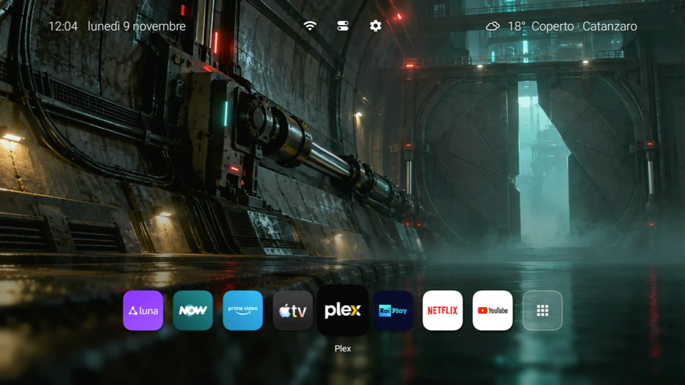
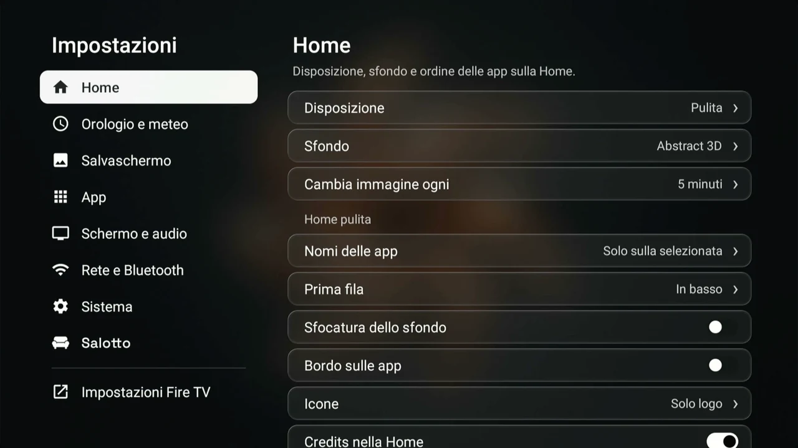
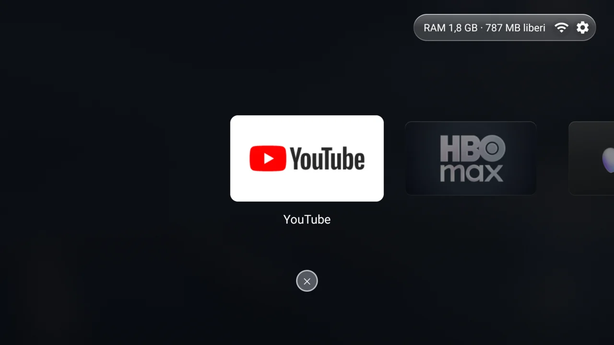

<b>English</b> · <a href="README.it.md">Italiano</a>

 

A clean Home for Fire TV Stick: your apps, the backdrop, the time and the weather. No ads, no recommended content and no autoplaying videos.

## Supported Fire TVs

| Code | Model | Generation | Year | Features |
|---|---|---|---|---|
| `AFTKM` | Fire TV Stick 4K | 2nd | 2023 | All |
| `AFTKRT` | Fire TV Stick 4K Max | 2nd | 2023 | All |
| `AFTKA` | Fire TV Stick 4K Max | 1st | 2021 | Some limited |
| `AFTSSS` | Fire TV Stick | 3rd | 2020 | Some limited |
| `AFTSS` | Fire TV Stick Lite | 1st | 2020 | Some limited |

## Installation

Installa Salotto guides every step from the computer, and with Remove Salotto it puts everything back as it was.

| Computer | Installer |
|---|---|
| Mac Apple Silicon | **[Download Installa Salotto for Mac](https://github.com/simplemal/salotto-tv/releases/latest/download/Installa-Salotto-Mac.dmg)** |
| Windows | **[Download Installa Salotto for Windows](https://github.com/simplemal/salotto-tv/releases/latest/download/Installa-Salotto-Windows.exe)** |
| Linux | **[Download Installa Salotto for Linux](https://github.com/simplemal/salotto-tv/releases/latest/download/Installa-Salotto-Linux.AppImage)** (AppImage: make it executable, then open it) |

## What it does

- **Home:** a grid of your apps, backdrops that follow the weather and the time of your city, or illustrations, 3D sculptures and night cities that change on their own.
- **Ten languages:** Italian, English, Spanish, French, German, Portuguese, Russian, Arabic, Hindi and Chinese.
- **First start:** a guided tour before the Home.
- **Screensavers:** the same pictures, with just the time and date.
- **Control center:** hold Menu for Wi-Fi, Bluetooth, timer, brightness and, where possible, the blue light filter.
- **Task manager:** hold Back.
- **Less tracking:** the installation turns off the advertising, telemetry and Alexa packages, limits the advertising ID and stops sending usage data. If Fire OS turns them back on, Salotto tells you.
- **Updates:** signed and checked before they are installed, one step at a time on screen.

Salotto connects only to Open-Meteo for the weather and to GitHub for updates. No root and no changes to the system: it stays a normal app, and it can be uninstalled.

## How it looks

Clean Home

Circular Home. Clean, Circular and Glass are chosen in Appearance › Layout

  
  

Choosing the backdrop · Task manager

## How the repository is made

- `home/app`: the Salotto app, in Java, with no external libraries apart from a small QR code generator.
- `home/cover`: a small app that keeps the update page on screen while Android replaces Salotto.
- `distro`: install and uninstall scripts, package lists, guides and publishing tools.

To build you need JDK 17, the Android SDK and Gradle 8.9: `gradle :app:assembleDebug` from the `home` folder.

## Updates and errors

Every version is a [release](https://github.com/simplemal/salotto-tv/releases) with the APK, `update.json` and its signature. Salotto installs only what is signed with the right key.

If a code appears on the TV, look for it in [ERRORI.md](ERRORI.md). For anything else [open an issue](https://github.com/simplemal/salotto-tv/issues/new).

## Problems and new ideas

To report a problem or suggest a new feature, [open an issue on GitHub](https://github.com/simplemal/salotto-tv/issues/new): all you need is a free GitHub account. First look through the [open issues](https://github.com/simplemal/salotto-tv/issues): if yours is already there, add a comment or a 👍.

- **Problem:** give the Fire TV model and the Salotto version (in Settings → About Salotto), what you did and what happened. If there is an error code, write it down or attach a photo of the screen. For installation problems, press “Report a problem” in Installa Salotto: it saves a file on the Desktop to attach.
- **New feature:** describe what you would need and when you would use it.

## Support Salotto

Salotto is free and open source. If it has been useful to you and you want to support its development, including for new platforms, you can buy me a coffee ☕

## License

[PolyForm Noncommercial 1.0.0](LICENSE): it can be used, studied, modified and built upon for free for non-commercial purposes. Selling it requires the author's permission. Credits and third-party software are in [NOTICE.md](NOTICE.md).

Salotto is an independent project. It is not affiliated with, sponsored or endorsed by Amazon, Apple or the other brands mentioned, which belong to their respective owners.
